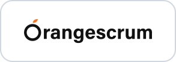

<p align="center">
  
</p>

<h1 align="center">Orangescrum MCP Server</h1>

<p align="center">
  <b>The official Model Context Protocol (MCP) server for Orangescrum: a cloud-hosted bridge that gives your AI tools secure, real-time access to projects, tasks, users, sprints, Test Case Management, releases, Scaled Agile, risk, resource, attendance, and leave management, the Knowledge Base (Wiki), and documents in your Orangescrum workspace.</b>
</p>

<!-- Line 1 · Project -->
<p align="center">
  <a href="https://github.com/Orangescrum/orangescrum-mcp-server"></a>
  <a href="https://github.com/Orangescrum/orangescrum-mcp-server/stargazers"></a>
  <a href="LICENSE"></a>
  <a href="https://helpdesk.orangescrum.com/guide/mcp/introduction"></a>
</p>

<!-- Line 2 · Protocol & access -->
<p align="center">
  <a href="https://modelcontextprotocol.io"></a>
  <a href="server.json"></a>
  <a href="https://helpdesk.orangescrum.com/guide/mcp/authentication"></a>
  <a href="https://www.orangescrum.com"></a>
</p>

<!-- Line 3 · Supported modules -->
<p align="center">
  
  
  
  
  
  
  
  
  
  
  
  
  
</p>

<p align="center">
  <a href="https://helpdesk.orangescrum.com/guide/mcp/quickstart"><b>Getting started</b></a> ·
  <a href="https://helpdesk.orangescrum.com/guide/mcp/tools"><b>Supported tools</b></a> ·
  <a href="https://helpdesk.orangescrum.com/guide/mcp/authentication"><b>Security &amp; admin</b></a> ·
  <a href="https://helpdesk.orangescrum.com/guide/mcp/troubleshooting"><b>Troubleshooting</b></a>
</p>

---

The **official Orangescrum MCP Server** is a cloud-based bridge between your Orangescrum workspace and compatible AI tools. Once connected, it lets those tools work with **projects, tasks, users, the epic, feature, and story hierarchy, sprints, timelogs, Test Case Management, versions and releases, Scaled Agile, risk management, resource management, attendance, leave, checklists, Knowledge Base (Wiki) pages, saved project context, and uploaded documents** in real time. Authentication uses **OAuth 2.1 with PKCE**, so every action runs as the signed-in user and respects their existing Orangescrum roles and permissions.

With the Orangescrum MCP Server, you can:

* **Summarize and search** projects, tasks, sprints, defects, releases, Wiki pages, and documents without switching tools.
* **Create and update** tasks, stories, defects, test cases, timelogs, releases, and Knowledge Base pages from natural language.
* **Plan and track** sprints, program increments, and release readiness with live data.
* **Automate repetitive work**, like turning meeting notes into tasks or a spec into a backlog.

Connect once, then describe what you want. There is no tab switching and no copy-pasting: your AI selects and runs the right actions.

It's built for project managers, developers, QA teams, and delivery leads who work in AI assistants or IDEs and want to use Orangescrum data without constantly switching context.

> [!IMPORTANT]
> **The recommended endpoint is `https://mcp.orangescrum.com/mcp/partner`.** It uses OAuth 2.1, so you never paste an API key into a config file. Your client registers itself, opens a browser for you to sign in, and asks you to pick one workspace. For setup steps, see [Quickstart](https://helpdesk.orangescrum.com/guide/mcp/quickstart).

## One-click setup

Pick your AI client below to add the official Orangescrum MCP Server. **One-click install** buttons add the server for you, so you don't need to edit any JSON config by hand. The others open that client's step-by-step guide.

<table align="center">
  <tr>
    <td align="center" width="150">
      <a href="docs/clients/chat-apps.md#claude-claudeai-desktop-and-cowork"><br><b>Claude</b></a>
      <br><sub>Custom connector</sub>
    </td>
    <td align="center" width="150">
      <a href="docs/clients/coding-agents.md#claude-code"><br><b>Claude Code</b></a>
      <br><sub>One command</sub>
    </td>
    <td align="center" width="150">
      <a href="docs/clients/coding-agents.md#openai-codex-cli"><br><b>Codex</b></a>
      <br><sub>One command</sub>
    </td>
    <td align="center" width="150">
      <a href="docs/clients/chat-apps.md#chatgpt"><br><b>ChatGPT</b></a>
      <br><sub>Custom connector</sub>
    </td>
    <td align="center" width="150">
      <a href="https://vscode.dev/redirect/mcp/install?name=Orangescrum&config=%7B%22url%22%3A%22https%3A%2F%2Fmcp.orangescrum.com%2Fmcp%2Fpartner%22%2C%22type%22%3A%22http%22%7D"><br><b>VS Code</b></a>
      <br><sub>One-click install</sub>
    </td>
  </tr>
  <tr>
    <td align="center" width="150">
      <a href="docs/clients/coding-agents.md#opencode"><br><b>OpenCode</b></a>
      <br><sub>One command</sub>
    </td>
    <td align="center" width="150">
      <a href="docs/clients/chat-apps.md#gemini-app"><br><b>Gemini</b></a>
      <br><sub>Custom app</sub>
    </td>
    <td align="center" width="150">
      <a href="docs/clients/coding-agents.md#google-antigravity-ide-and-cli"><br><b>Antigravity</b></a>
      <br><sub>IDE and CLI</sub>
    </td>
    <td align="center" width="150">
      <a href="docs/clients/chat-apps.md#perplexity"><br><b>Perplexity</b></a>
      <br><sub>Custom connector</sub>
    </td>
    <td align="center" width="150">
      <a href="https://cursor.com/en/install-mcp?name=Orangescrum&config=eyJ1cmwiOiJodHRwczovL21jcC5vcmFuZ2VzY3J1bS5jb20vbWNwL3BhcnRuZXIifQ=="><br><b>Cursor</b></a>
      <br><sub>One-click install</sub>
    </td>
  </tr>
  <tr>
    <td align="center" width="150">
      <a href="docs/clients/chat-apps.md#muse"><br><b>Muse</b></a>
      <br><sub>Chat prompt</sub>
    </td>
    <td align="center" width="150">
      <a href="docs/clients/coding-agents.md#hermes-agent"><br><b>Hermes Agent</b></a>
      <br><sub>config.yaml</sub>
    </td>
    <td align="center" width="150">
      <a href="docs/clients/coding-agents.md#openclaw"><br><b>OpenClaw</b></a>
      <br><sub>One command</sub>
    </td>
    <td align="center" width="150">
      <a href="docs/clients/coding-agents.md#github-copilot-cli"><br><b>GitHub Copilot</b></a>
      <br><sub>CLI and IDE</sub>
    </td>
    <td align="center" width="150">
      <a href="docs/clients/chat-apps.md#grok"><br><b>Grok</b></a>
      <br><sub>Custom connector</sub>
    </td>
  </tr>
  <tr>
    <td align="center" width="150">
      <a href="https://kiro.dev/launch/mcp/add?name=orangescrum&config=%7B%22url%22%3A%22https%3A%2F%2Fmcp.orangescrum.com%2Fmcp%2Fpartner%22%7D"><br><b>Kiro</b></a>
      <br><sub>One-click install</sub>
    </td>
    <td align="center" width="150">
      <a href="docs/clients/coding-agents.md#devin-desktop-formerly-windsurf"><br><b>Devin Desktop</b></a>
      <br><sub>Settings</sub>
    </td>
    <td align="center" width="150">
      <a href="docs/clients/coding-agents.md#zed"><br><b>Zed</b></a>
      <br><sub>Settings</sub>
    </td>
    <td align="center" width="150">
      <a href="docs/clients/chat-apps.md#lm-studio"><br><b>LM Studio</b></a>
      <br><sub>mcp.json</sub>
    </td>
    <td align="center" width="150">
      <a href="docs/clients/orchestration.md#n8n"><br><b>n8n</b></a>
      <br><sub>Workflow node</sub>
    </td>
  </tr>
</table>

<p align="center"><sub>More than 70 clients are covered in the <a href="#supported-clients">client guides</a>.</sub></p>

### Let your agent do the setup

Most AI agents can add the server and start the sign-in themselves. Paste this prompt into your agent (Claude Code, Codex, OpenCode, Cursor, Copilot, Antigravity, and others):

```
Set up the Orangescrum MCP Server for the AI client you are running in.
Read https://raw.githubusercontent.com/Orangescrum/orangescrum-mcp-server/main/INSTALL.md
and follow it exactly: add the server https://mcp.orangescrum.com/mcp/partner
using my client's own method, keep my existing MCP servers, walk me through
the browser sign-in, then call get_current_user to confirm it works.
```

[INSTALL.md](INSTALL.md) tells the agent how to find its own client's steps, add the server without touching other settings, hand the sign-in to you, and check the connection.

Or add the server yourself:

| Client | Command or configuration |
| --- | --- |
|  Claude Code | `claude mcp add --transport http orangescrum https://mcp.orangescrum.com/mcp/partner`, then `/mcp` to sign in |
|  Codex CLI | `codex mcp add orangescrum --url https://mcp.orangescrum.com/mcp/partner`, then `codex mcp login orangescrum` |
|  OpenCode | Add `{"mcp": {"orangescrum": {"type": "remote", "url": "https://mcp.orangescrum.com/mcp/partner"}}}` to `opencode.json`, then `opencode mcp auth orangescrum` |
|  GitHub Copilot CLI | `copilot mcp add --transport http orangescrum https://mcp.orangescrum.com/mcp/partner`, then `/mcp auth` |
|  Cursor | Add `{"mcpServers": {"orangescrum": {"url": "https://mcp.orangescrum.com/mcp/partner"}}}` to `~/.cursor/mcp.json` |
|  VS Code | Add `{"servers": {"orangescrum": {"type": "http", "url": "https://mcp.orangescrum.com/mcp/partner"}}}` to `.vscode/mcp.json` |
|  Google Antigravity | Add `{"mcpServers": {"orangescrum": {"serverUrl": "https://mcp.orangescrum.com/mcp/partner"}}}` to `~/.gemini/config/mcp_config.json` |
|  Claude.ai / Claude Desktop | **Customize → Connectors → + Add → Add custom connector**, name it `Orangescrum`, and paste the server URL |
|  ChatGPT | **chatgpt.com/plugins → + → Add custom MCP server**, paste the server URL, and choose **OAuth** |
|  Gemini app | **Settings → Connected Apps → Custom apps**, paste the server URL, and sign in |
|  Grok | **grok.com/connectors → New Connector → Custom**, paste the server URL, and sign in |
|  Perplexity | **Plugins → Add custom → Add MCP connector → Remote**, paste the server URL, and choose **OAuth 2.0** |
|  Orca, T3 Code, and other agent orchestrators | Add the server to each agent they run (see [Agent orchestrators](docs/clients/coding-agents.md#agent-orchestrators-orca-t3-code-and-similar)) |
|  n8n, Zapier, Make, Dify, and agent SDKs | See [Orchestration tools and SDKs](docs/clients/orchestration.md) |
|  Any other MCP client | Use the server URL `https://mcp.orangescrum.com/mcp/partner`, or see [INSTALL.md](INSTALL.md) |

## Contents

* [One-click setup](#one-click-setup)
* [Supported clients](#supported-clients)
* [Plugin packaging and compatibility](#plugin-packaging-and-compatibility)
* [Supported modules and tools](#supported-modules-and-tools)
* [How the server exposes tools](#how-the-server-exposes-tools)
* [MCP gateways](#mcp-gateways)
* [Before you start](#before-you-start)
* [Data and security](#data-and-security)
* [How it works](#how-it-works)
* [Example workflows](#example-workflows)
* [Tips and tricks](#tips-and-tricks)
* [Admin notes: managing access](#admin-notes-managing-access)
* [Security](#security)
* [Support and feedback](#support-and-feedback)
* [Disclaimer](#disclaimer)

---

## Supported clients

The Orangescrum MCP Server works with any client that speaks remote MCP over Streamable HTTP with OAuth. Step-by-step setup for more than 70 clients:

| Guide | Covers |
| --- | --- |
| [Coding agents and IDEs](docs/clients/coding-agents.md) | Claude Code, OpenAI Codex CLI, OpenCode, Cursor, VS Code, GitHub Copilot CLI, Visual Studio, Google Antigravity, Gemini CLI, Devin Desktop (formerly Windsurf), Zed, Cline, Kilo Code, Roo Code, Continue, Goose, Amp, Kiro, Warp, JetBrains Junie and AI Assistant, Factory Droid, Augment Code, Crush, Qwen Code, Trae, Hermes Agent, OpenClaw, and agent orchestrators such as Orca and T3 Code |
| [Chat apps and assistants](docs/clients/chat-apps.md) | Claude (Claude.ai, Desktop, and Cowork), ChatGPT, Gemini, Grok, Perplexity, Mistral Le Chat, Microsoft Copilot Studio, Muse, Raycast AI, Notion AI, Slack, LibreChat, Open WebUI, Jan, LM Studio, Cherry Studio, and Msty Studio |
| [Orchestration tools and SDKs](docs/clients/orchestration.md) | n8n, Zapier, Make, Dify, Flowise, Langflow, the OpenAI, Anthropic, xAI, and Gemini APIs, the official MCP SDKs, OpenAI Agents SDK, Claude Agent SDK, Vercel AI SDK, LangChain and LangGraph, Pydantic AI, LlamaIndex, Mastra, CrewAI, Google ADK, Microsoft Agent Framework, Semantic Kernel, AutoGen, Agno, Strands Agents, Cloudflare Agents, smolagents, Haystack, and AWS Bedrock AgentCore Gateway |
| [INSTALL.md](INSTALL.md) | Instructions an AI agent can read and follow to set itself up |

The server also supports any **local, STDIO-only MCP client** through the [`mcp-remote`](https://www.npmjs.com/package/mcp-remote) proxy, which runs on `localhost`, completes the OAuth flow in your browser, and forwards requests to the hosted server.

> [!NOTE]
> Microsoft 365 Copilot declarative agents and Gemini Enterprise are not supported yet: both require an OAuth client secret, and this server registers public clients without one.

> [!TIP]
> Menus in hosted apps change often. If a step does not match what you see, check [Client setup](https://helpdesk.orangescrum.com/guide/mcp/clients) or your client's own MCP documentation.

---

## Plugin packaging and compatibility

This repository publishes the same MCP server and skills in several package formats so clients can use their native discovery and installation flows:

| Format | Manifest and configuration | Shared components |
| --- | --- | --- |
| [Agent Plugins v1](https://agent-plugins.org/) | [`plugin.json`](plugin.json) and [`mcp.json`](mcp.json) | [`skills/`](skills/) |
| Claude Code plugin | [`.claude-plugin/plugin.json`](.claude-plugin/plugin.json) and [`.claude-plugin/marketplace.json`](.claude-plugin/marketplace.json) | [`.mcp.json`](.mcp.json) and [`skills/`](skills/) |
| Cursor plugin | [`.cursor-plugin/plugin.json`](.cursor-plugin/plugin.json) | [`.mcp.json`](.mcp.json) and [`skills/`](skills/) |
| Gemini extension | [`gemini-extension.json`](gemini-extension.json) | MCP server configuration embedded in the manifest |
| MCP Registry | [`server.json`](server.json) | Remote server metadata |

The skills in [`skills/`](skills/) are what every packaged plugin installs. See [`skills/README.md`](skills/README.md) for what each one does.

Both `mcp.json` and `.mcp.json` are intentional. Agent Plugins requires the root `mcp.json` filename and its portable transport vocabulary (`streamable-http`); existing clients continue to use `.mcp.json` and their native vocabulary (`http`). Keep their endpoint settings aligned when changing either file. `npm run validate` fails if they drift.

To install the Claude Code plugin with its skills:

```
/plugin marketplace add Orangescrum/orangescrum-mcp-server
/plugin install orangescrum@orangescrum
```

---

## Supported modules and tools

Tools are organized by module and intent (read or write). Each module has its own OAuth scopes. A user approves scopes on the consent screen, and the workspace administrator caps which scopes can ever be granted.

| Module | Tools | Scopes |
| --- | :---: | --- |
| **Projects** | 5 | `mcp:projects.read` · `mcp:projects.write` |
| **Tasks**: comments, dependencies, links, labels, attachments, statuses, types | 27 | `mcp:tasks.read` · `mcp:tasks.write` |
| **Users** | 3 | `mcp:users.read` |
| **Test Case Management**: cases, suites, plans, runs, scenarios, strategies, baselines, datasets, defects | 69 | `mcp:tests.read` · `mcp:tests.write` |
| **Versions and releases**: items, readiness, approvals, release notes, dependencies, go-live checklists, blackout windows, customer impact, templates, analytics | 60 | `mcp:releases.read` · `mcp:releases.write` |
| **Scaled Agile**: release trains, program increments, iterations, program board, PI objectives, ROAM risks, confidence votes, WSJF, Inspect and Adapt, flow metrics | 50 | `mcp:safe.read` · `mcp:safe.write` |
| **Risk management**: risk register, workflow, comments, links, watchers, approvals, heat map, reports | 27 | `mcp:risks.read` · `mcp:risks.write` |
| **Checklists**: groups, items, templates, per-item checklists | 20 | `mcp:checklists.read` · `mcp:checklists.write` |
| **Leave**: leave types, balances, holidays, requests, approvals, reports | 12 | `mcp:leaves.read` · `mcp:leaves.write` |
| **Resource management**: availability, capacity, utilization, allocation report, skills | 8 | `mcp:resources.read` |
| **Sprints** | 7 | `mcp:sprints.read` · `mcp:sprints.write` |
| **Attendance**: clock in and out, records, team status, dashboard, reports | 7 | `mcp:attendance.read` · `mcp:attendance.write` |
| **Backlog hierarchy**: epics, features, stories, subtasks | 5 | `mcp:epics.read` · `mcp:epics.write` |
| **Knowledge Base (Wiki)**: shelves, books, page trees, pages, versions, comments, attachments, backlinks, action items, reviews, links to work items, search | 36 | `mcp:wiki.read` · `mcp:wiki.write` |
| **Timelogs** | 3 | `mcp:timelogs.read` · `mcp:timelogs.write` |
| **Project context** ("memory") | 2 | `mcp:context.read` · `mcp:context.write` |
| **Document management**: search across uploaded documents (RAG) | 1 | `mcp:documents.read` |
| **Total** | **342** | |

Every request also needs the base scope `mcp:use`, which is what clients fall back to when they don't know the granular vocabulary.

The server also provides **2 prompts**, `daily_standup` and `overdue_report`, which most clients surface as slash commands, and **3 resources** (your projects, your tasks, and saved project context) that a client can attach as context.

Module-specific conditions:

* **Sprints** and **Scaled Agile** tools are available when the workspace plan includes those modules.
* **Write scopes are opt-in.** A read-only grant gives you a research assistant that cannot change anything.
* **Entitlement changes apply immediately.** When an administrator widens or narrows a workspace's allowed scopes, connected clients see the change on their next request, with no need to reconnect.

> [!NOTE]
> For the complete, current tool reference, including the scope each tool requires, see [Tools](https://helpdesk.orangescrum.com/guide/mcp/tools).

---

## How the server exposes tools

The Orangescrum MCP Server sends **every tool the connection can use in a single `tools/list` response**, with no pagination cursor. Tool names are plain `snake_case` verbs such as `list_projects`, `create_task`, `get_release_readiness`, and `start_sprint`, so an agent can call any of them directly without a discovery step.

This has two benefits:

* Clients that stop after a few pages of tools, or that cache the first page only, still see the whole surface.
* Agents can plan multi-step work (for example, find a project, then its active sprint, then its open tasks) without extra lookups.

If your client lets you limit which tools are active, turn off the modules you don't use to keep its context free for the task at hand.

## MCP gateways

If you're using an MCP gateway or proxy, point it at the same URL. No override is needed: the full tool list arrives in one page, and the gateway forwards the user's `Authorization: Bearer` token unchanged.

```
https://mcp.orangescrum.com/mcp/partner
```

Gateways must pass through the `WWW-Authenticate` header on `401` responses so the client can discover the authorization server.

---

## Before you start

Check that your environment meets these requirements before you set up the server.

### Prerequisites

The requirements depend on how you connect:

#### For supported clients

* An **Orangescrum Cloud workspace** with **MCP enabled** by an administrator (see [Admin notes](#admin-notes-managing-access))
* An Orangescrum sign-in (email and password, or Google sign-in)
* Access to **the client of choice**
* A modern browser to complete the OAuth 2.1 authorization flow

#### For IDEs or local clients (desktop setup)

* An **Orangescrum Cloud workspace** with MCP enabled
* A supported IDE (for example, **VS Code or Cursor**) or a custom MCP-compatible client
* **Node.js v18+** installed if your client needs the local MCP proxy ([`mcp-remote`](https://www.npmjs.com/package/mcp-remote))
* A modern browser for completing the OAuth sign-in

---

## Data and security

The server enforces several security controls:

* All traffic is encrypted in transit over **HTTPS (TLS 1.2 or later)**.
* **OAuth 2.1 with PKCE** and **dynamic client registration** (RFC 7591): there is no shared secret, no client secret, and no API key on disk.
* **Consent is per workspace.** Each token is bound to the single workspace picked at sign-in, so an assistant cannot reach into another one.
* **Scopes are the boundary.** A tool that needs a scope the user did not grant returns `403` naming the missing scope.
* Data access respects the user's existing Orangescrum roles and project membership. A project the user cannot see reads as not found.
* **Short-lived tokens.** Access tokens last 1 hour; refresh tokens last 30 days and rotate on every exchange.

For a deeper overview of the security model and admin controls, see:

* [Authentication](https://helpdesk.orangescrum.com/guide/mcp/authentication)
* [Troubleshooting](https://helpdesk.orangescrum.com/guide/mcp/troubleshooting)

---

## How it works

### Architecture and communication

1. A supported client connects to the server endpoint:

   ```
   https://mcp.orangescrum.com/mcp/partner
   ```

   The server speaks JSON-RPC 2.0 over Streamable HTTP and negotiates MCP protocol revisions `2025-11-25`, `2025-06-18`, `2025-03-26`, and `2024-11-05`.
2. The first unauthenticated request returns `401` with a `WWW-Authenticate` header. The client reads `/.well-known/oauth-protected-resource` and `/.well-known/oauth-authorization-server`, registers itself, and opens a browser.
3. The user signs in, picks a workspace, and approves scopes. The client exchanges the authorization code (with its PKCE verifier) for an access token and a refresh token.
4. Every request then carries `Authorization: Bearer <access-token>`, and the client refreshes silently in the background.

### Permission management

Access is granted only to data the user already has permission to view in Orangescrum. Two things must agree before a scope is usable: the workspace must **allow** it, and the user must **approve** it on the consent screen. A client that asks for more than the workspace allows is clamped down to the allowed set rather than refused.

### Rate limits

Requests are rate limited per minute and per day. A `429` response means you hit a limit; well-behaved clients back off and retry. See [rate limits](https://helpdesk.orangescrum.com/guide/mcp/authentication#rate-limits).

---

## Example workflows

Once connected, you can run tasks like these from your client.

### Projects, tasks, and users

* **Search**: "Find all high-priority open tasks in Project Apollo."
* **Create/update**: "Create a task titled 'Redesign onboarding' and assign it to Priya."
* **Bulk create**: "Make five tasks from these notes."
* **Users**: "List the users in my workspace and show what Priya is assigned."

### Sprints and backlog

* **Status**: "How is the current sprint in Project Apollo tracking?"
* **Plan**: "Break this spec into an epic, features, and stories."
* **Move work**: "Assign these three stories to the next sprint."

### Test Case Management

* **Report**: "File a critical defect for the checkout timeout we just saw on staging."
* **Run**: "Rerun every failed test from yesterday's regression run."
* **Compare**: "Compare this run against the last baseline."

### Releases

* **Readiness**: "Is release 4.2 ready? What is still blocking it?"
* **Notes**: "Generate the release notes for 4.2."
* **Calendar**: "Which releases fall inside a blackout window this month?"

### People and time

* **Timelogs**: "Log 2 hours on task 1482 for today."
* **Capacity**: "Who on the platform team is overloaded next week?"
* **Leave**: "Apply for leave on Friday and show my remaining balance."

### Combined tasks

* **Link work**: "Link these three tasks to the 4.2 release and add them to its checklist."
* **Find documentation**: "Search our uploaded documents for the API rate-limit policy."
* **Move work forward**: "Move task 1482 to 'In Review' and add a comment that the PR is up."

> [!NOTE]
> Actual capabilities vary depending on your scopes, your role, your workspace plan, and your client platform.

---

## Tips and tricks

### Set a default workspace context

Update your [AGENTS.md](https://agents.md/) with the Markdown below to reduce discovery calls, save time and tokens, and keep result sets small.

```md
## Orangescrum MCP

When connected to orangescrum:
- **MUST** use project_id = "YOUR_PROJECT_ID" unless I name another project
- **MUST** use `limit: 20` for ALL list and search tools
- **MUST** call get_current_user once and reuse the user id instead of looking it up again
- **MUST** ask before any delete_* tool
```

### Save project context

Use the `add_project_context` tool to store facts the assistant should always know about a project (definitions of done, naming conventions, who owns what). `get_project_context` and the project context resource bring them back in later sessions.

### Use skills

If you're using a desktop client like Claude, you can create or reuse skills for repeated tasks. [See the default Orangescrum MCP skills](skills/).

### Use the built-in prompts

Run `daily_standup` for a standup summary of your work, or `overdue_report` for everything past its due date.

---

## Admin notes: managing access

If you're an administrator preparing your organization to use the Orangescrum MCP Server, review the points below.

### Manage, monitor, and revoke access

* **Enable MCP for the workspace:**
  MCP is off until it is enabled for the company and the allowed scopes are chosen. Until then, every authorization attempt is refused regardless of who signs in. Contact [support@orangescrum.com](mailto:support@orangescrum.com) or your account manager to enable it.
* **Scope ceiling:**
  The workspace's allowed scopes are the most any user can grant. Narrow them to read-only scopes for a cautious rollout.
* **Instant revocation:**
  Disabling the workspace entitlement fails in-flight tokens on their very next request. There is no waiting for token expiry.
* **End-user controls:**
  Individual users can disconnect a client at any time by removing it in the client; to force a fresh sign-in, remove and re-add the server.
* **Audit logging:**
  Every tool call is recorded in the audit trail with the user, the workspace, the status code, and the response time.

### Troubleshooting common issues

* **The sign-in page loops, or authorization never completes.**
  The most common cause on a first connection is that MCP is not enabled for any workspace you belong to, so the consent screen has nothing to offer. Ask an administrator to enable it. Blocked pop-ups or third-party cookies in the browser the client opened can also stop the flow.
* **A tool returns 403 naming a scope.**
  The token authenticated fine, but that capability was not granted. Reconnect and approve the scope. If it isn't offered on the consent screen, the workspace doesn't allow it yet.
* **The assistant can't see a project you know exists.**
  The token is bound to one workspace. Connect a second time and pick the other workspace.

For more, see [Troubleshooting](https://helpdesk.orangescrum.com/guide/mcp/troubleshooting).

---

## Security

Model Context Protocol (MCP) lets AI agents connect to tools and Orangescrum data using your account's permissions, which creates powerful workflows but also structural risks. Any MCP client or server you enable (for example, IDE plugins, desktop apps, hosted MCP servers, or "one-click" integrations) can cause an AI agent to perform actions on your behalf.

Large language models (LLMs) are vulnerable to [prompt injection](https://owasp.org/www-community/attacks/PromptInjection) and related attacks (such as indirect prompt injection and [tool poisoning](https://invariantlabs.ai/blog/mcp-security-notification-tool-poisoning-attacks)). These attacks can instruct the agent to exfiltrate data or make unintended changes without explicit requests.

To reduce risk, only use trusted MCP clients and servers, carefully review which tools and data each agent can access, and apply least privilege (read-only scopes first, a non-critical workspace for trials). For any high-impact or destructive action, require human confirmation and monitor the audit trail for unusual activity. To report a vulnerability, see [SECURITY.md](SECURITY.md).

---

## Support and feedback

We use your feedback to improve the Orangescrum MCP Server. If you hit a bug or limitation, or have a suggestion:

* Read the [MCP guide](https://helpdesk.orangescrum.com/guide/mcp/introduction) on the Orangescrum Help Center.
* Email [support@orangescrum.com](mailto:support@orangescrum.com) for problems with the hosted server, sign-in, scopes, or your workspace.
* Open an [issue](https://github.com/Orangescrum/orangescrum-mcp-server/issues/new/choose) for anything in this repository: docs, manifests, the registry entry, or skills.

---

## Disclaimer

MCP clients can perform actions in Orangescrum with your existing permissions. Use least privilege, review high-impact changes before confirming, and monitor the audit trail for unusual activity.

Product names and logos of AI clients shown in this README are trademarks of their respective owners. They are used only to identify the clients this server works with and do not imply endorsement.
